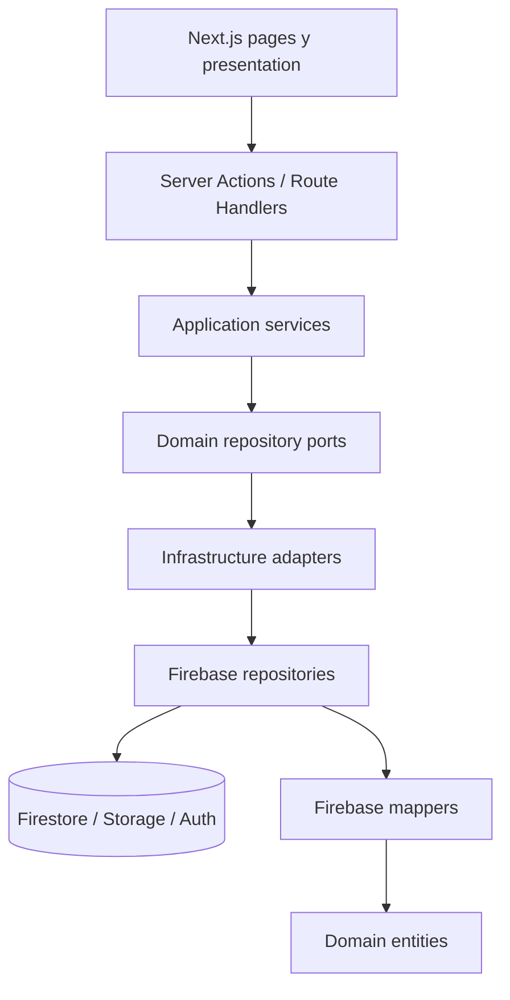
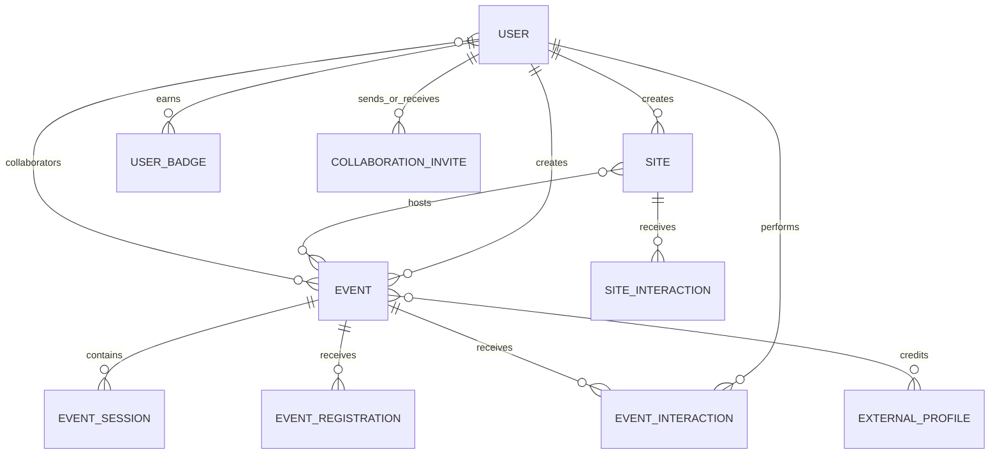

# Arquitectura y datos

## 1. Estilo arquitectónico

QHPA usa una arquitectura inspirada en **DDD + puertos y adaptadores**, integrada con Next.js App Router.



La separación está presente y es valiosa, pero no es totalmente estricta. Hay accesos desde presentación al contenedor DI, repositorios cliente expuestos directamente y lógica de autorización distribuida.

## 2. Capas

### `domain`

Contiene:

- entidades y value objects;
- estados y tipos de negocio;
- interfaces de repositorio;
- contrato de Storage.

No debería importar Firebase, React ni Next.js.

### `application`

Contiene:

- servicios que orquestan puertos;
- DTOs y validación Valibot;
- agregaciones como el feed de eventos.

Algunos servicios son delegadores del repositorio y otros incluyen decisiones, por ejemplo sincronización de rango de fechas o scoring.

### `infraestructure`

Nombre histórico mal escrito; debería ser `infrastructure` o `infraestructura`, pero renombrarlo afecta muchos imports.

Contiene:

- repositorios Firebase;
- DTOs de persistencia;
- mappers dominio/Firebase;
- adaptadores que implementan puertos;
- contenedores DI cliente y servidor;
- Storage.

### `presentation`

Contiene:

- componentes por feature;
- ViewModels y mappers de presentación;
- hooks, stores y utilidades visuales;
- funciones cacheadas para perfil/Studio.

### `app`

Es la frontera Next.js:

- pages, layouts y route groups;
- Server Actions;
- APIs;
- proxy de autenticación;
- componentes UI y layouts compartidos;
- stores globales pequeños.

## 3. Inyección de dependencias

`infraestructure/di/container.ts` construye repositorios, mappers, adaptadores y servicios para servidor. `container.client.ts` resuelve el lado cliente.

Patrón habitual:

```text
Action/API
  -> createServerContainer()
  -> servicio de aplicación
  -> puerto de dominio
  -> adaptador
  -> repositorio Firebase
```

Fortaleza: las acciones no necesitan conocer detalles de Firestore.

Deuda:

- el contenedor se crea en muchas entradas;
- el lado cliente no conserva siempre la misma frontera de adaptadores;
- `presentation/profile/lib/cachedProfileData.ts` conoce el contenedor de infraestructura;
- faltan factories de test o inyección sencilla para acciones.

## 4. Next.js y fronteras de ejecución

### Server Components

Usados para cargar datos, metadata y layouts protegidos.

### Client Components

Usados para formularios, mapas, modales, drawers, interacción y Firebase Auth cliente.

### Server Actions

Son la principal interfaz de escritura. Deben encargarse de:

- autenticar;
- autorizar;
- validar input;
- invocar servicios;
- invalidar caché;
- devolver errores aptos para UI.

### Route Handlers

Exponen auth/me, likes, perfil agregado, categorías, moderación, sesiones y revalidación.

### Proxy

`proxy.ts` usa `next-firebase-auth-edge` para sesión y redirección. Protege explícitamente `/profile`, `/mis-eventos`, `/sites` y `/eventos/create`.

Studio se protege adicionalmente mediante `StudioGate`, que exige token y plan Premium. Otras rutas sensibles dependen de controles en página/acción. Se requiere una matriz única de rutas y permisos.

## 5. Autenticación

### Servidor

- Firebase Admin.
- `next-firebase-auth-edge`.
- Cookie `AuthToken`, HTTP-only, SameSite Lax.
- Cookies seguras en producción.
- Duración configurada: 12 días.
- Rotación mediante `COOKIE_SECRET_CURRENT` y `COOKIE_SECRET_PREVIOUS`.

### Cliente

- Firebase Web Auth.
- Persistencia en memoria.
- `AuthProvider` consulta `/api/auth/me` y puede iniciar sesión con custom token.
- Soporte opcional para emulador.
- Soporte opcional para tenant de Identity Platform.

Riesgo: servidor y cliente deben mantenerse sincronizados; fallos del custom token o refresh pueden dejar UI y cookie en estados distintos.

## 6. Firebase y persistencia

La base nombrada es `quehaypahacer-db`.

Se usan dos clientes contra esa base:

- `firebase-admin/firestore` para operaciones estándar.
- `@google-cloud/firestore` para pipelines/consultas Enterprise de Studio.

No son dos fuentes de datos lógicas, pero sí dos SDKs y superficies de tipos/configuración que aumentan complejidad.

## 7. Colecciones confirmadas

| Colección/ruta | Propósito |
|---|---|
| `users/{uid}` | Cuenta, identidad, participación, plan, verificación y perfil. |
| `usernames/{username}` | Reserva transaccional de username. |
| `users/{uid}/preferences` | Preferencias por categoría. |
| `users/{uid}/badges` | Insignias obtenidas. |
| `users/{uid}/eventInteractions` | Proyección reciente para trayectoria/perfil. |
| `events/{eventId}` | Evento principal. |
| `events/{eventId}/sessions` | Sesiones multifecha. |
| `events/{eventId}/registrations` | Registros del evento padre. |
| `events/{eventId}/sessions/{sessionId}/registrations` | Registros por sesión. |
| `events/{eventId}/interactions` | Likes, vistas, compartidos y clics por usuario. |
| `sites/{siteId}` | Sitios. |
| `sites/{siteId}/interactions` | Interacciones del sitio. |
| `categories` | Taxonomía de eventos/sitios. |
| `campaigns` | Campañas y CTAs. |
| `contactos` | Mensajes de contacto. |
| `badges` | Catálogo de insignias. |
| `collaborationInvites` | Invitaciones entre usuarios. |
| `externalProfiles` | Colaboradores sin cuenta. |
| `supportTickets` | Soporte de Studio. |

No se encontraron `firestore.rules` ni `storage.rules` en el repositorio. Pueden estar administradas fuera del repo, pero actualmente no son auditables ni versionables aquí.

## 8. Entidades y relaciones



### User

Identidad, username, participación, plan, verificación, visibilidad, bio, medios y redes.

### Event

Contenido, categoría, autor denormalizado, ubicación, precio, registro, moderación, medios, fechas, colaboradores y analíticas.

### EventSession

Fecha/lugar/precio/registro propios dentro de un evento multifecha. Puede heredar portada del padre u otra sesión.

### Site

Lugar con categoría, ubicación, horario, medios, autor, estados y analíticas.

### Campaign

Promoción interna programada, prioridad, imágenes, entidad relacionada y CTA.

### Studio

Read-models para overview, eventos, registros, sitios, audiencia, colaboración y soporte.

## 9. Denormalización

Se denormalizan datos para reducir lecturas:

- autor dentro de evento/sitio;
- `collaboratorsData` dentro del evento;
- proyección de interacciones bajo usuario;
- contadores/analíticas dentro de entidades.

Ventaja: cards y listados requieren menos joins.

Costo: nombre/avatar y contadores pueden quedar obsoletos. Debe existir una política explícita de actualización o reconciliación.

## 10. Compatibilidad de esquemas

Los mappers aceptan formas antiguas y nuevas:

- `author.id` o `author.uid`;
- ciudad string u objeto;
- coordenadas y GeoPoint;
- portadas con URL directa, temporal o variante procesada;
- consultas de perfil con fallbacks sin `orderBy`.

Esto confirma una migración de datos gradual. Falta definir cuándo se completa y cuándo se elimina compatibilidad heredada.

## 11. Imágenes y medios

- `next/image` conserva optimización de entrega.
- Eventos pueden guardar variantes `desktop/tablet/mobile` durante procesamiento.
- Sitios guardan original, thumbnail y marker URL según tipo de medio.
- Storage conserva paths y URLs.
- Formularios manejan estados `processing`, `ready`, `error` y URLs temporales.

La timeline de perfil prioriza variante procesada de evento y evita ampliar thumbnails de sitio.

## 12. Caché

### Next Cache Components

Habilitado en `next.config.ts`.

### Sin cache handler propio

`cache-handler.js` y `cacheHandlers` se eliminaron el **2026-10-10** (no invalidaba tags). Hoy se usa el handler en memoria por defecto de Next, **por instancia**: `updateTag`/`revalidateTag` invalidan solo la instancia que ejecuta la escritura; las demás sirven datos viejos hasta expirar su `cacheLife`.

### Tags en uso (`cacheTag`/`updateTag`/`revalidateTag`)

- Eventos: `event-list`, `event-{id}`, `event-slug-{slug}`, `event-sessions-{id}`, `event-interaction-{eventId}-{uid}`, `all-events`, `weekend-events`, `featured-events`, `category-{slug}`, `collection-{slug}`, `explore`, `sitemap`.
- Sitios: `site-list`, `site-{id}`, `sites-{uid}`, `site-type-{type}`, `site-collection-{slug}`, `featured-sites`.
- Perfil: `user-profile-{uid}`, `user-preferences-{uid}`, `preference-events-{uid}`, `profile-events-{uid}`, `profile-sites-{uid}`, `profile-likes-{uid}`, `profile-badges-{uid}`, `profile-stats-{uid}`.
- Otros: `active-categories`, `categories`, `active-campaigns`, `verified-creators-v1`, `studio-multidate-{id}`.

Desajustes corregidos el **2026-10-10**: las escrituras invalidaban `user-events-*` en vez de `profile-events-{uid}`; `app/actions/sites/_revalidate.ts` ahora también invalida `profile-sites-{uid}`; `POST /api/events/moderation` (Route Handler, sin `updateTag`) usa `revalidateTag(tag, { expire: 0 })`.

### Caché de perfil y Studio

Funciones con `use cache`, `cacheLife` y tags reducen lecturas. Deben auditarse todas las escrituras para garantizar invalidación.

Los límites de mes del Studio (mes actual/anterior/siguiente) se calculan en `America/Bogota` con `bogotaMonthStart` (`infraestructure/firebase/repositories/studio/StudioFirebaseRepository.ts`, test `bogotaMonthStart.test.ts`), no en UTC del servidor.

## 13. Consistencia y transacciones

Casos que requieren atomicidad:

- reserva/cambio de username;
- aceptación/cancelación de invitaciones;
- agregar/quitar colaboradores;
- contadores e interacciones;
- publicación + estados de moderación;
- eliminación de cuenta y recursos relacionados.

Firestore no permite transacciones entre bases, pero el proyecto usa una sola base nombrada con dos SDKs. Aun así, operaciones distribuidas entre Auth, Firestore y Storage no tienen rollback global.

## 14. Inconsistencias arquitectónicas

1. `infraestructure` está mal escrito y se convirtió en convención de facto.
2. `EventsFirebaseREpository.ts` usa capitalización inconsistente.
3. DTOs de aplicación y Firebase se solapan sin guía formal.
4. Algunos componentes/acciones conocen detalles de infraestructura.
5. Studio concentra demasiadas responsabilidades en un repositorio de más de 2.000 líneas.
6. Validación Valibot no es uniforme en todos los inputs.
7. Autorización se repite entre proxy, gates, páginas y acciones.
8. Los mocks de read-models (`presentation/sites/lib/mock-data.ts`, `studioEventsMock.ts`) se eliminaron el **2026-10-10**; ya no hay mocks fuera de tests.
9. Compatibilidad de datos antiguos no tiene fecha de retirada.
10. La caché es por instancia: no hay invalidación entre instancias de Cloud Run.

## 15. Decisiones arquitectónicas recomendadas

- Mantener capas y puertos; no hacer reescritura total.
- Centralizar helpers de autenticación/autorización para acciones y APIs.
- Dividir Studio por capacidades solo después de tests de caracterización.
- Versionar reglas e índices de Firebase.
- Definir un contrato único para media procesada.
- Documentar DTO de entrada, entidad y DTO de persistencia para evitar mezcla.
- Establecer una estrategia de migración de esquemas y retirar fallbacks por fecha.
- Reintroducir un cache handler compartido solo si se mide la necesidad y con invalidación real de tags.
- No renombrar `infraestructure` durante el cierre del MVP salvo refactor mecánico aislado y validado.