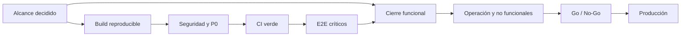

# Plan de cierre y release

## 1. Objetivo de cierre

Entregar un MVP público de QHPA que permita, sin datos ficticios ni fallos conocidos críticos:

- descubrir eventos y sitios en Ibagué;
- registrarse e iniciar sesión;
- crear/publicar/moderar eventos y sitios;
- interactuar con contenido;
- gestionar perfil y trayectoria;
- operar Premium/Studio en el alcance realmente implementado;
- desplegar, observar, respaldar y revertir el servicio.

“Terminar” no significa añadir todas las ideas. Significa cerrar un alcance acordado con calidad operable.

## 2. Decisiones de alcance previas

Antes de estimar fecha de lanzamiento, producto/negocio debe decidir:

1. ¿Studio entra completo en MVP o se reduce a módulos sin mock?
2. ¿Premium se comercializa en lanzamiento o sigue por contacto privado?
3. ¿Quién modera y verifica creadores?
4. ¿Sitios y eventos salen juntos o por fases?
5. ¿Se mantiene Ibagué como única ciudad?
6. ¿Qué analíticas son promesa comercial y cuáles internas?
7. ¿Qué términos, privacidad y política de contenido se publican?

Sin estas respuestas, la fecha es especulativa.

## 3. Orden obligatorio de ejecución

### Fase 0. Congelar y hacer reproducible

- Elegir pnpm como gestor único y retirar `package-lock.json` tras acuerdo.
- Fijar Node/pnpm y añadir scripts `typecheck`, `test`, `test:e2e`.
- Separar y commitear cambios locales por unidad lógica.
- Crear rama/PR de estabilización.
- Respaldar Firestore/Storage antes de migraciones.
- Crear baseline de bugs y validaciones.

**Salida:** cualquier miembro puede instalar y reproducir el mismo estado.

### Fase 1. Resolver P0 técnicos y de seguridad

1. Alinear `@google-cloud/storage` y recuperar build verde.
2. Cerrar/proteger `/api/admin/seed-badges`.
3. Implementar o eliminar `/api/revalidation/events`.
4. Versionar Firestore/Storage rules e índices.
5. Resolver cuota y estrategia Redis.
6. Implementar invalidación real o retirar custom cache handler.
7. Retirar datos mock de Studio o recortar la feature.
8. Eliminar logs de depuración peligrosos.

**Salida:** build verde, sin endpoints administrativos abiertos y sin datos falsos visibles.

### Fase 2. CI y calidad mínima

- Workflow de PR con instalación congelada, typecheck, lint, tests y build.
- Reducir los 66 errores ESLint a cero.
- Mantener warnings con baseline temporal y dueño.
- Añadir global error boundary.
- Añadir pruebas de integración con emuladores.
- Añadir Playwright para flujos críticos.
- Añadir axe y smoke responsive.

**Salida:** ninguna regresión crítica llega a `develop/main` sin señal.

### Fase 3. Cierre funcional

- Auth, verificación de email y eliminación de cuenta.
- Evento estándar: borrador, publicación, moderación, detalle e interacción.
- Evento multifecha: sesiones, conversión, registro y detalle.
- Sitios: creación, moderación, mapa, detalle y vinculación.
- Perfil: identidad, redes, privacidad, timeline e insignias.
- Studio acordado: datos reales, registros, asistencia, sitios, soporte.
- Colaboradores Premium e invitaciones.
- Membresía/contacto coherente con operación comercial.

**Salida:** criterios de aceptación y E2E verdes por flujo.

### Fase 4. Operación y no funcionales

- Logging/error tracking/alertas.
- Backup + restore ensayado.
- Rate limiting.
- Prueba de carga y costes.
- Sitemap dinámico/SEO/schema.org.
- Accesibilidad WCAG AA.
- Optimización de imágenes/bundle.
- Runbooks de despliegue, rollback e incidentes.

**Salida:** el equipo puede detectar, responder y recuperar el servicio.

### Fase 5. Release controlado

- Deploy dev y smoke completo.
- Prueba con datos de ensayo aislados.
- Revisión de seguridad y privacidad.
- Go/no-go firmado.
- Deploy producción con ventana y responsables.
- Smoke postdeploy.
- Monitorización intensiva inicial.
- Tag y release notes.

## 4. Backlog priorizado

### Estado P0 (**2026-10-10**)

Trabajo local, sin commit ni despliegue. Detalle en `06-calidad-seguridad-y-deuda.md` §3.

| P0 | Estado | Pendiente |
|---|---|---|
| P0-1 Storage/typecheck/build | Cerrado (código) | `pnpm build` bloqueado en prerender por billing de `quehaypahacer-develop`. |
| P0-2 Endpoint seed + IDOR en Server Actions | Cerrado | Matriz de autorización P1 (`/api/profile/*?uid=`). |
| P0-3 Rules/índices | Parcial | Diff contra consola, tests con emulador, despliegue; prod con 0 índices (búsqueda por texto no funciona sin índice tokenizado; el resto hace table scan). |
| P0-4 Studio mock | Cerrado | `getFormResponses`/`getAudienceSummary` sin implementar ni consumir. |
| P0-5 Redis/cache | Cerrado | Decidir baja de la instancia Redis. |
| P0-6 CI | Parcial | Borrar `package-lock.json` (acuerdo del owner) y configurar secrets/vars en GitHub. |
| Backup/rollback | Abierto | Sin cambios. |
| Términos/privacidad y ownership | Abierto | Sin cambios. |


### P0: no lanzar

- Build/typecheck Storage.
- Endpoint seed sin autorización.
- Rules/índices no versionados/auditados.
- Redis lleno e invalidación incompleta.
- Studio con mock presentado como dato real.
- CI inexistente.
- Backup/rollback no probado.
- Términos/privacidad y ownership operativo sin definir.

### P1: cerrar para MVP estable

- Rate limit y helpers de autorización.
- Error boundary y manejo de errores uniforme.
- E2E críticos.
- Observabilidad.
- Cero errores ESLint.
- Sitemap de detalles y structured data.
- Accesibilidad.
- Limpieza de logs.
- Revalidación de caché coherente.
- Runbooks y matriz de ambientes.

### P2: post-MVP o mejora controlada

- Renombrar `infraestructure`.
- Normalizar idioma/naming interno.
- Refactor profundo de Studio/formularios.
- Reclamación de perfiles externos.
- Sincronización automática de datos denormalizados.
- Pagos propios.
- Multi-ciudad.
- Notificaciones push.
- Analítica avanzada/atribución por colaborador.

## 5. Dependencias entre tareas



## 6. Matriz mínima de flujos de aceptación

| Flujo | Caso feliz | Errores obligatorios |
|---|---|---|
| Registro | Email y Google crean usuario/username. | Duplicado, token inválido, rollback parcial. |
| Login | Cookie + custom token sincronizados. | Credencial inválida, refresh, logout. |
| Evento | Draft -> publish -> moderación. | No verificado, inválido, ajeno, upload fallido. |
| Multifecha | Sesiones completas y rango sincronizado. | Sesión draft, solape, conversión incompleta. |
| Registro | Cupo y respuestas persistidos. | Evento pasado, lleno, duplicado. |
| Sitio | Draft -> publish -> detalle/mapa. | Ubicación/media inválida, rechazo. |
| Perfil | Editar identidad/medios/privacidad. | Username ocupado, upload fallido. |
| Premium | Gate servidor y UI coherentes. | Basic no accede a capacidades Premium. |
| Colaboración | Invitar/aceptar/quitar. | Duplicado, actor incorrecto, carrera. |
| Studio | KPIs y tablas reales. | Datos vacíos, error Firestore, permisos. |

## 7. Comandos de gate objetivo

Tras añadir scripts al package:

```bash
pnpm install --frozen-lockfile
pnpm typecheck
pnpm lint
pnpm test
pnpm test:e2e
pnpm build
```

Todos deben finalizar con código 0. No se permite “compila, pero falla typecheck” como release válido.

## 8. Definition of Done de release

### Código

- [ ] Build reproducible y verde.
- [x] Typecheck verde (**2026-10-10**).
- [ ] 0 errores ESLint.
- [ ] Unit/integration/E2E críticos verdes.
- [x] Sin mocks de producción no etiquetados (**2026-10-10**).
- [x] Sin endpoints administrativos abiertos (**2026-10-10**).

### Datos y seguridad

- [ ] Rules e índices versionados y probados.
- [ ] Backup y restauración ensayados.
- [ ] Migraciones registradas por ambiente.
- [ ] Rate limiting activo.
- [ ] Secrets rotables y sin exposición.
- [ ] Eliminación/privacidad verificadas.

### Producto/UX

- [ ] Alcance firmado.
- [ ] Consumer/creator y basic/premium coherentes.
- [ ] Moderación operable.
- [ ] Responsive y accesibilidad validados.
- [ ] Sin promesas de pagos/analytics no implementadas.

### Operación

- [ ] Monitoreo y alertas.
- [ ] Runbooks.
- [ ] Responsables de guardia/lanzamiento.
- [ ] Rollback probado.
- [ ] Costos y cuotas monitoreados.

### Legal/administrativo

- [ ] Términos y privacidad publicados.
- [ ] Consentimiento y retención definidos.
- [ ] Propiedad de cuentas/dominios verificada.
- [ ] Proceso de soporte y moderación asignado.

## 9. Go / No-Go

**No-Go automático** si ocurre cualquiera:

- build/typecheck rojo;
- P0 abierto;
- rules no auditadas;
- backup no restaurable;
- datos mock visibles como reales;
- auth/publicación/registro sin E2E;
- secretos o endpoint admin expuestos;
- sin responsable operativo durante lanzamiento.

## 10. Alcance recomendado de primera salida

Para reducir riesgo:

- Ibagué únicamente;
- eventos estándar y sitios como núcleo;
- multifecha Premium solo si E2E y Studio están listos;
- Premium por contacto, sin pagos internos;
- analíticas limitadas a métricas demostrablemente reales;
- moderación operada por equipo identificado;
- campañas administradas internamente;
- sin reclamación de perfiles externos ni features sociales nuevas.